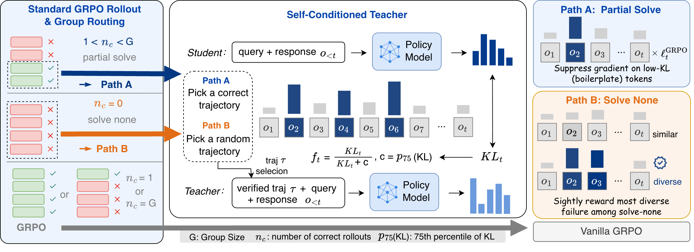

# SC-GRPO

**[EMNLP 2026 Findings]**

Main code for **Learning from Own Solutions: Self-Conditioned Credit Assignment for Reinforcement Learning with Verifiable Rewards** ([paper](https://arxiv.org/abs/2606.18810)).

SC-GRPO constructs a self-conditioned teacher using the model's own rollouts and uses token-level KL to weight the GRPO update. This repository contains the complete rLLM training framework, the modified veRL backend, and data preparation, training, and evaluation entry points for Math, LiveCodeBench, AppWorld, and WebShop.

## Method overview



SC-GRPO assigns token-level credit using the distribution shift induced by conditioning on a reference rollout. It uses the same policy for teacher and student scoring, with no external teacher or process reward model.

1. Generate a group of rollouts and verify their rewards.
2. Select a verified reference for partial-solve groups; use a random failed reference for solve-none groups.
3. Compute teacher-to-student token-level KL and map it to bounded weights, `KL/(KL+c)`.
4. Weight the GRPO update and add a small diversity signal for solve-none groups. Single-correct and all-correct groups use standard GRPO.

See [Section 5 of the paper](https://arxiv.org/html/2606.18810v1#S5) for the algorithm.

## Results

The paper evaluates mathematical reasoning, code generation, and multi-turn agentic tasks. The table below reports **Avg@8 (%)** from Table 1; each query is sampled eight times.

| Method | AIME 2024 | AIME 2025 | LCB v6 | AppWorld | WebShop | Average |
| --- | ---: | ---: | ---: | ---: | ---: | ---: |
| GRPO | 41.67 | 34.16 | 39.59 | 12.50 | 68.93 | 39.37 |
| DAPO | 43.75 | 37.91 | 40.74 | 13.99 | 71.50 | 41.58 |
| **SC-GRPO** | **51.67** | **42.08** | **43.22** | **22.36** | **77.88** | **47.44** |

SC-GRPO improves average performance by **8.07 percentage points over GRPO** and **5.86 points over DAPO**. Full results, Pass@8, and analyses are in the [paper](https://arxiv.org/html/2606.18810v1#S6).

## Installation

We used two conda environments: **`rllm` for general training** and **`rllm-webshop` for WebShop training**. Both use Linux x86_64, PyTorch 2.6.0 with CUDA 12.4, and the following inference stack:

| Package | General training (`rllm`) | WebShop training (`rllm-webshop`) |
| --- | --- | --- |
| Python | 3.11.8 | 3.10.0 |
| PyTorch | 2.6.0+cu124 | 2.6.0+cu124 |
| vLLM | 0.8.5.post1 | 0.8.5.post1 |
| SGLang | 0.4.6.post5 | 0.4.6.post5 |
| Transformers | 4.51.1 | 4.51.1 |
| TensorDict | 0.8.3 | 0.6.2 |
| Ray | 2.54.0 | 2.54.0 |
| FlashAttention | 2.7.4.post1 | 2.7.4.post1 |
| FlashInfer | 0.2.2.post1+cu124torch2.6 | 0.2.2.post1+cu124torch2.6 |
| NumPy | 1.26.4 | 1.26.4 |
| PEFT | 0.18.1 | 0.18.1 |

Environment setup started from the **rLLM `scripts/install_verl.sh` used in our experiments**. The release includes a portable version at [scripts/install_verl.sh](scripts/install_verl.sh). Create the environment for your task and run it from this repository:

```bash
# General training
conda create -n rllm python=3.11.8 -y
conda activate rllm
bash scripts/install_verl.sh

# WebShop training: use a separate environment
conda create -n rllm-webshop python=3.10.0 -y
conda activate rllm-webshop
bash scripts/install_verl.sh
```

The table records the installed experiment environments. The installer is the setup starting point: it installs TensorDict 0.6.2 and leaves several packages, including Ray, unpinned. `requirements-gpu.txt` is a separate installation reference that currently pins Ray 2.55.1 and TensorDict 0.6.2. Use the versions in the table when matching the experiment environments.

Both environments use **CUDA 12.4 and C++11 ABI=false**. FlashAttention uses a `cp311` wheel for general training and a `cp310` wheel for WebShop; the installer selects the wheel for the active Python version. FlashInfer uses the CUDA 12.4 / PyTorch 2.6 wheel. For local wheel files, supply their paths:

```bash
FLASH_ATTN_WHEEL=/path/to/flash_attn.whl \
FLASHINFER_WHEEL=/path/to/flashinfer_python.whl \
  bash scripts/install_verl.sh
```

WebShop additionally uses **OpenJDK 11.0.23, Pyserini 0.17.0, and PyJNIus 1.7.0** in its training environment. See [environment setup](docs/environments.md) for the backend and additional package versions. The launchers default to one node with eight GPUs.

## Main experiments

The base model is `Qwen/Qwen3-8B`, with thinking disabled. All tasks use eight rollouts per prompt, eight prompts per training batch, and learning rate `1e-6`.

| Task | Training data | Training size | Max response tokens | Steps |
| --- | --- | ---: | ---: | ---: |
| Math | DAPO-Math-17k | 4,000 | 8,192 | 500 |
| LiveCodeBench v6 | LCB v6 | 131 | 8,192 | 320 |
| AppWorld | Official train split | 90 | 12,288 | 110 |
| WebShop | Sample from training pool | 2,400 | 8,192 | 300 |

Math and WebShop sampling use a configurable seed (default: 42). LiveCodeBench preparation follows the existing setup from [SDPO](https://arxiv.org/abs/2601.20802).

### Math: AIME 2024 and 2025

```bash
python -m examples.dapo_math.prepare_math_data --train_size 4000 --seed 42
bash examples/dapo_math/train_dapo_math.sh
```

### LiveCodeBench v6

```bash
python -m examples.livecodebench.prepare_livecodebench_data
bash examples/livecodebench/train_livecodebench.sh
```

### AppWorld

Export task IDs and start AppWorld servers in a separate environment following [environment setup](docs/environments.md). Then prepare the registry and train from the training environment:

```bash
export APPWORLD_TASK_IDS_FILE=/path/to/appworld-task-ids.json
python -m examples.appworld.prepare_appworld_data \
  --dataset_name appworld_official_test_normal --val_split test_normal
export APPWORLD_REMOTE_ENVIRONMENT_URLS=http://127.0.0.1:8100,http://127.0.0.1:8101
bash examples/appworld/train_appworld_agent.sh
```

### WebShop

Install the WebShop backend as described in [environment setup](docs/environments.md).

```bash
export WEBSHOP_ROOT=/path/to/webshop
python -m examples.webshop.prepare_webshop_data \
  --train_size 2400 --seed 42 --split_mode official \
  --dataset_name webshop_text_official
bash examples/webshop/train_webshop_agent.sh
```

## Configuration

SC-GRPO defaults to top-64 scoring with an aggregate tail probability, `KL/(KL+c)` weights, `c=max(p75,1e-4)`, and exploration coefficient `0.1`. Group routing and teacher prompts are implemented in the training framework. Public configuration keys use `rllm.sc_grpo`.

Every launcher accepts Hydra overrides. Models, GPU counts, and total steps can also be supplied through environment variables:

```bash
MODEL_PATH=/path/to/Qwen3-8B N_GPUS_PER_NODE=8 \
  bash examples/livecodebench/train_livecodebench.sh trainer.test_freq=16

DRY_RUN=1 bash examples/livecodebench/train_livecodebench.sh
```

`DRY_RUN=1` prints the command without starting Ray or training. Logs default to the console. To use SwanLab, set `SWANLAB_API_KEY` yourself and pass `trainer.logger='[console,swanlab]'`.

Prepared data are stored under `~/.cache/sc-grpo`; set `RLLM_DATA_DIR` to use a shared data directory.

## Evaluation

Evaluate a Hugging Face model or exported checkpoint with eight sampled trajectories per query:

```bash
bash scripts/evaluate.sh math /path/to/exported-model
bash scripts/evaluate.sh livecodebench /path/to/exported-model
bash scripts/evaluate.sh appworld /path/to/exported-model
bash scripts/evaluate.sh webshop /path/to/exported-model
```

AppWorld and WebShop use the same environment variables as training. Evaluation sets `trainer.val_only=True`, so it performs no optimizer updates. Validation logs include `avg@8` and `pass@8` for each data source. To export an FSDP actor checkpoint:

```bash
python -m verl.model_merger merge --backend fsdp \
  --local_dir /path/to/global_step_N/actor --target_dir /path/to/exported-model
```

## Code map

- `rllm/engine/sc_grpo.py`: trajectory extraction, grouping, and teacher tokenization.
- `rllm/engine/rewrite_prompt.py`: task-specific self-conditioning prompts.
- `rllm/trainer/verl/agent_ppo_trainer.py`: rollout routing and teacher batch construction.
- `verl/verl/workers/actor/dp_actor.py`: teacher/student scoring, KL weighting, and actor update.
- `examples/`: four main experiments.

## Tests

```bash
python -m pytest -q tests/test_sc_grpo_equivalence.py
python scripts/verify_release.py
python scripts/check_public_release.py
```

## Acknowledgments and license

Built on [rLLM](https://github.com/rllm-org/rllm) and [veRL](https://github.com/volcengine/verl). Existing copyright headers are retained. See [LICENSE](LICENSE), [NOTICE](NOTICE), and the vendored veRL attribution in `verl/Notice.txt`.

## Citation

```bibtex
@misc{shan2026learningsolutionsselfconditionedcredit,
      title={Learning from Own Solutions: Self-Conditioned Credit Assignment for Reinforcement Learning with Verifiable Rewards}, 
      author={Yingyu Shan and Yuhang Guo and Zihao Cheng and Zeming Liu and Xiangrong Zhu and Xinyi Wang and Jiashu Yao and Wei Lin and Hongru Wang and Heyan Huang},
      year={2026},
      eprint={2606.18810},
      archivePrefix={arXiv},
      primaryClass={cs.LG},
      url={https://arxiv.org/abs/2606.18810}, 
}
```
